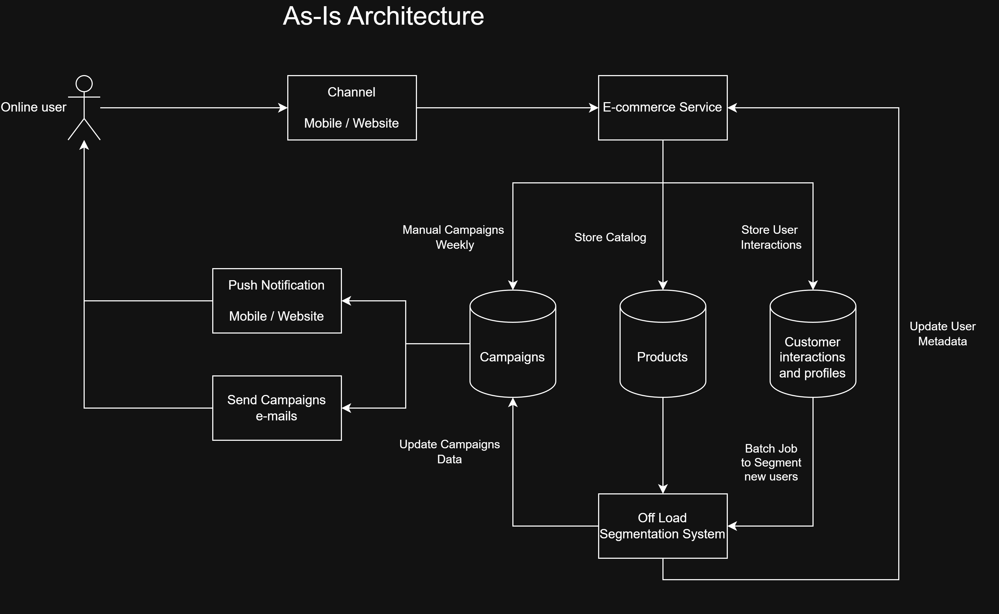
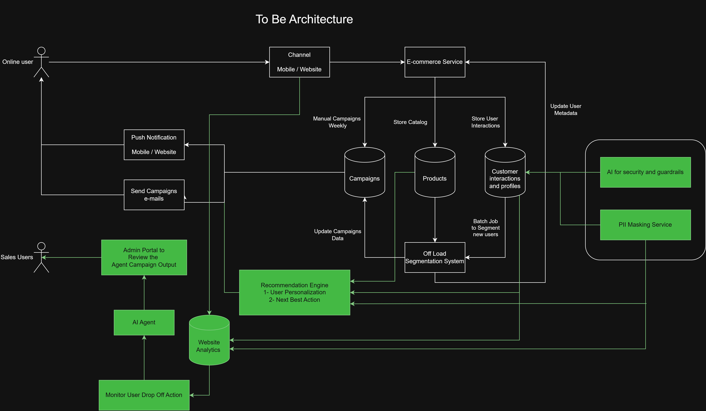

## 1. Architecture Overview

We need to build an AI and Agents System to automate the Marketing process for an e-commerce application.

---

### 1.1. Problem Statement and Pain Points

- **Static Recommendations** → Replace group-based recommendations with individual user personalization.
- **User Lost in Navigation** → Monitor where users drop off: search, cart, billing, etc.
- **Next-Best Action** → Trigger contextual actions based on real-time user interactions.
- **Manual Campaigns** → Replace manual campaign creation with AI-automated generation and scheduling.
- **User Drop-Off Monitoring** → A dedicated monitoring agent tracks drop-off events from Website Analytics and triggers next-best action responses automatically.

---

### 1.2. Goals and Non-Goals

**Goals**
- Increase CSAT to 85%
- Increase Conversion Rate to 2.5%
- Decrease campaign preparation time by 80%
- Increase the number of active customers by 15%

**Non-Goals**
- Decrease return items
- Increase annual profits
- Increase the number of new customers

---

### 1.3. As-Is Architecture

**Assumptions:**
- Concurrent users based on last 6 months: ~50 users; peak (Ramadan, Holidays): ~100 users.
- Each user must have at least 10 transactions for personalization to be meaningful.
- User metadata must exist: gender, age, interests, etc.
- No existing AI/ML pipeline — fully manual campaign and recommendation process today.

---

### 1.4. Architecture Principles

| # | Principle | Description | Linked Business Goal |
|---|-----------|-------------|----------------------|
| P1 | **Personalization over Generalization** | Every AI output must be tailored to the individual user's behavior and metadata, not group averages. | Increase Conversion Rate to 2.5% |
| P2 | **Human Oversight by Default** | No AI-generated campaign or next-best action goes live without a human approval gate. | Decrease campaign prep time by 80% |
| P3 | **Privacy First (PDPL Compliance)** | User PII is processed with consent, minimized at collection, and never used outside the defined marketing scope. | Increase active customers by 15% |
| P4 | **Explainability over Black-Box** | Every AI recommendation must produce a human-readable reason that a business user can understand and audit. | Increase CSAT to 85% |
| P5 | **Security and Guardrails as a Component** | AI security checks and PII masking are built-in pipeline services, not afterthoughts reviewed only at ARB. | Increase active customers by 15% |

### 1.4.1. To-Be Architecture

---

### 1.5. Architecture Decisions and Trade-Offs

#### 1.5.1. ADR-001: LLM Deployment Strategy

| Field | Detail |
|---|---|
| **Context** | We need an LLM to power campaign generation and next-best action recommendations. Decision: managed API vs. self-hosted. |
| **Option 1** | Managed API (Azure OpenAI / GPT-4o) — faster to market, higher per-call cost, data leaves org boundary. |
| **Option 2** | Self-hosted open-source model (LLaMA 3, Mistral) — full data control, PDPL-friendly, high infra and MLOps overhead. |
| **Trade-offs** | API wins on speed and ops cost at low user scale. Self-hosting only justified at high volume or strict data residency with no cloud option. |
| **Decision** | ✅ **Managed API — Azure OpenAI** with data residency controls. At 50–100 concurrent users, self-hosting infra cost is not justified. Azure's data processing agreement satisfies PDPL. |
| **Review Trigger** | Revisit if monthly token cost exceeds 1,000 USD or user base grows 5×. |

#### 1.5.2. ADR-002: Knowledge Retrieval and Vector Database

| Field | Detail |
|---|---|
| **Context** | User history, product catalog, and campaign templates need semantic retrieval to power AI agents. |
| **Option 1** | Pinecone (managed) — zero ops, strong performance, vendor lock-in, extra cost. |
| **Option 2** | pgvector (PostgreSQL extension) — reuses existing DB, no new vendor, sufficient for <1M vectors. |
| **Option 3** | Weaviate (self-hosted) — flexible and feature-rich, requires dedicated ops. |
| **Trade-offs** | pgvector avoids a new vendor and keeps data co-located with the e-commerce DB. Pinecone is better at massive scale. Weaviate adds ops burden unnecessarily at this stage. |
| **Decision** | ✅ **pgvector** — sufficient for 50–100 users and <1M vectors. Keeps data residency simple for PDPL. |
| **Review Trigger** | Revisit if vector count exceeds 5M or query latency exceeds 200ms p95. |

#### 1.5.3. ADR-003: Real-Time vs. Batch Processing

| Field | Detail |
|---|---|
| **Context** | AI recommendations can be served in real-time (per request) or pre-computed in batch (nightly/hourly). |
| **Option 1** | Real-time inference on every request — always fresh, latency risk, higher compute cost. |
| **Option 2** | Batch pre-computation (nightly) — fast response, stale data, cheapest. |
| **Option 3** | Hybrid — batch pre-computes embeddings and base recommendations; real-time re-ranks using current session context. |
| **Trade-offs** | Pure real-time is risky at <200ms SLA with an LLM in the loop. Pure batch misses live session signals. Hybrid balances cost, freshness, and latency. |
| **Decision** | ✅ **Hybrid** — nightly batch for personalization embeddings; real-time re-ranking at request time using session context. Meets <200ms UX target. |

---

### 1.6. Architecture Review Board (ARB)

#### 1.6.1. Security and Privacy (PDPL)

- [ ] PII encrypted at rest and in transit
- [ ] User consent captured before data is used for personalization
- [ ] Data retention max 12 months for raw interaction logs
- [ ] PII Masking Service applied before data reaches the AI pipeline
- [ ] RBAC applied to all pipeline components

#### 1.6.2. AI Evaluation and Reliability

- [ ] Recommendations evaluated offline (precision@k) before deployment
- [ ] LLM outputs tested for hallucination and brand-voice compliance
- [ ] Fallback to rule-based recommendations if confidence score is below threshold

#### 1.6.3. Cost and Performance

- [ ] LLM API cost monitored — alert at 80% of monthly cap
- [ ] Latency SLA: <200ms recommendations

#### 1.6.4. Human Oversight

- [ ] Campaign drafts require marketing team approval before sending
- [ ] AI next-best actions surfaced as suggestions, not auto-executed
- [ ] Override mechanism available for any AI decision

#### 1.6.5. Review Outcome and Approval

- [ ] All HIGH risk items resolved before go-live
- [ ] Sign-off: Architecture Lead, Security Officer, Marketing Owner, DPO
- [ ] Next ARB review: 3 months post-launch

---

### 1.7. Automated Architecture Guardrail

The system enforces guardrails: **runtime** (built into the architecture).

#### Runtime Guardrails (from the To-Be Architecture)

| Component | Role | Trigger |
|---|---|---|
| **PII Masking Service** | Intercepts customer interaction data and masks sensitive fields (name, phone, email) before it reaches the AI pipeline or LLM prompt | Every request that reads from Customer Interactions & Profiles DB |
| **AI for Security & Guardrails** | Monitors AI Agent outputs for policy violations, prompt injection, and off-brand content before campaigns are written to the Campaigns DB | Every AI Agent output |

---
